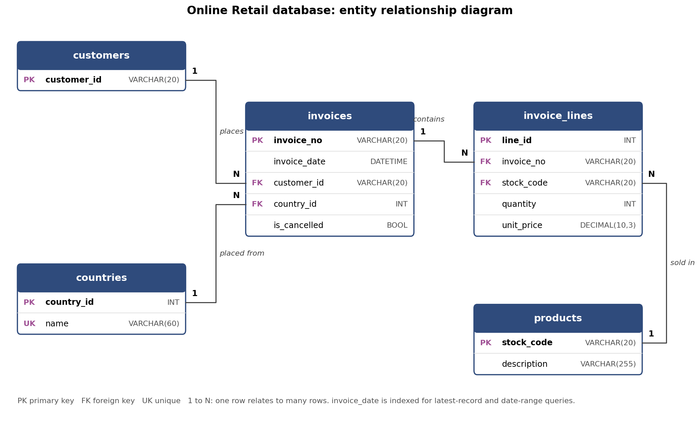

# ML Pipeline Formative, Group 30: Online Retail Daily Revenue

Group assignment: forecasting daily net revenue for an online retailer, with the data stored in MySQL and MongoDB and served through an API.

**Dataset:** Online Retail (UCI Machine Learning Repository / Kaggle), about 540,000 transaction lines from 1 Dec 2010 to 9 Dec 2011.
**Target:** daily net revenue (sales minus cancellations).

## Repository structure

```
database/             Task 2: database design
  erd.png, erd.mmd    entity relationship diagram
  sql/schema.sql      MySQL tables, indexes and daily_revenue view
  sql/queries.sql     SQL queries
  mongodb/            collection setup, sample documents and queries
  query_results.md    output of all queries
  run_queries.sh      runs the queries and saves the output
api/                  Task 3: FastAPI app (CRUD and time-series endpoints)
  main.py             app entry point
  sql_db.py           MySQL tables (SQLAlchemy)
  mongo_db.py         MongoDB collection and indexes
  schemas.py          request and response models
  routers/            /sql and /mongo endpoints
scripts/
  load_data.py        builds the schema and loads the cleaned data into MySQL and MongoDB
  predict.py          Task 4: fetches daily data from the API and forecasts the next trading day
  make_placeholder_model.py  stand-in model for testing predict.py without the Task 1 model
notebooks/            Task 1: EDA, analytical questions and model experiments
src/preprocessing.py  Task 1: cleaning, daily aggregation and feature code (reused by Task 4)
models/               Task 1: trained model (best_model.pkl) and its feature list
tests/                API tests for both databases
data/processed/       cleaned dataset from Task 1
docker-compose.yml    local MySQL and MongoDB
```

## Setup

Requirements: Python 3.12 and Docker.

```bash
git clone https://github.com/kbelyse/ML-Pipeline-Formative-Group-30.git
cd ML-Pipeline-Formative-Group-30
python -m venv .venv
source .venv/bin/activate          # Windows: .venv\Scripts\activate
pip install -r requirements.txt
cp .env.example .env

docker compose up -d               # starts MySQL on 3306 and MongoDB on 27017
python scripts/load_data.py        # runs schema.sql, then loads data/processed/transactions_clean.csv.gz into both
./database/run_queries.sh          # optional: reruns the Task 2 queries
uvicorn api.main:app --reload
```

Interactive API docs: http://127.0.0.1:8000/docs

## Task 1: Preprocessing, EDA and model

The notebook [`notebooks/time_series_eda_and_model.ipynb`](notebooks/time_series_eda_and_model.ipynb) covers:

- Understanding the data: time range (1 Dec 2010 to 9 Dec 2011), daily granularity, missing values (CustomerID kept as `UNKNOWN`, missing descriptions removed with zero prices, closed days not filled) and distributions.
- Cleaning: duplicates, non-product codes and invalid prices removed; cancellations kept so the target is net revenue.
- Six analytical questions with charts, including moving averages (Q1) and lagged values (Q2).
- Features: lags of 1, 2, 6 and 12 trading days, rolling means and standard deviation, lagged invoices and basket value, weekday.
- Experiments: naive baselines, Linear Regression, Ridge and Random Forest, tuned with `TimeSeriesSplit`. Linear Regression was best (MAE about £11,073 on the last 56 days) and is saved in `models/best_model.pkl`.

It runs in Google Colab or locally with `requirements.txt`.

## Task 2: Database design

### MySQL



| Table | Purpose |
|---|---|
| `countries` | One row per country |
| `customers` | One row per customer; missing IDs are stored as `UNKNOWN` so foreign keys stay valid |
| `products` | One row per stock code with its description |
| `invoices` | One row per invoice: date, customer, country and whether it was cancelled |
| `invoice_lines` | One row per product line of an invoice: quantity and unit price |

`invoices.invoice_date` is indexed for the latest-record and date-range queries. The view `daily_revenue` turns the transactions into the daily series used for forecasting (gross revenue, net revenue, invoices and quantity per day), with the same definitions as the Task 1 notebook. Codes use a case-sensitive collation because the data contains codes such as `15056BL` and `15056bl` that are different products.

Script: [`database/sql/schema.sql`](database/sql/schema.sql)

### MongoDB

Collection `transactions` has one document per invoice line. The customer and product are embedded because they are small and always read with the line, so a single read returns a complete record without joins. A `$jsonSchema` validator enforces field types and a positive unit price, and `invoice_date` is indexed for time-series queries.

```json
{
  "invoice_no": "536365",
  "invoice_date": {"$date": "2010-12-01T08:26:00Z"},
  "is_cancelled": false,
  "customer": {"customer_id": "17850", "country": "United Kingdom"},
  "product": {"stock_code": "85123A", "description": "WHITE HANGING HEART T-LIGHT HOLDER"},
  "quantity": 6,
  "unit_price": 2.55,
  "revenue": 15.3
}
```

Setup script: [`database/mongodb/collection_setup.js`](database/mongodb/collection_setup.js). More examples, including a cancellation and an unknown customer: [`database/mongodb/sample_documents.json`](database/mongodb/sample_documents.json)

### Queries

| # | MySQL ([`queries.sql`](database/sql/queries.sql)) | MongoDB ([`queries.js`](database/mongodb/queries.js)) |
|---|---|---|
| 1 | Latest 5 transactions | Latest record |
| 2 | Daily revenue for 1 to 8 Dec 2011 | Records between 1 and 8 Dec 2011 |
| 3 | Monthly net revenue and average per trading day | Daily revenue for 1 to 8 Dec 2011 |
| 4 | Lag 1, lag 6 and 6-day moving average (window functions) | 6-day moving average (`$setWindowFields`) |
| 5 | Top 5 international markets | Top 5 products in Nov 2011 |

All results are in [`database/query_results.md`](database/query_results.md). Both databases return the same daily figures as the Task 1 notebook, for example 2010-12-01: gross revenue 57,442.33 and 127 invoices.

## Task 3: API endpoints

The same endpoints exist for both databases. Replace `{db}` with `sql` (MySQL) or `mongo` (MongoDB).

| Method | Endpoint | Description |
|---|---|---|
| POST | `/{db}/transactions` | Create a transaction line |
| GET | `/{db}/transactions?limit=100&offset=0` | List transactions (paginated) |
| GET | `/{db}/transactions/{id}` | Get one transaction |
| PUT | `/{db}/transactions/{id}` | Update a transaction (only the fields sent) |
| DELETE | `/{db}/transactions/{id}` | Delete a transaction |
| GET | `/{db}/transactions/latest` | Latest record by invoice date |
| GET | `/{db}/transactions/range?start=YYYY-MM-DD&end=YYYY-MM-DD` | Records in a date range (both dates inclusive) |
| GET | `/{db}/daily?start=YYYY-MM-DD&end=YYYY-MM-DD` | Daily revenue series aggregated by the database |

`{id}` is an integer for MySQL (`line_id`) and a MongoDB ObjectId string for MongoDB.

**Validation** follows the Task 1 cleaning rules: `unit_price` must be above 0, sales need a positive quantity, cancellations (invoice number starting with `C`) need a negative quantity, and a missing `customer_id` is stored as `UNKNOWN`. Invalid input returns `422`, a missing record `404`, and an invalid date range or MongoDB id `400`.

### Example requests

```bash
# Create
curl -X POST http://127.0.0.1:8000/sql/transactions \
  -H "Content-Type: application/json" \
  -d '{"invoice_no": "581590", "stock_code": "22613", "description": "PACK OF 20 SPACEBOY NAPKINS",
       "quantity": 12, "invoice_date": "2011-12-09T13:00:00", "unit_price": 0.85,
       "customer_id": "12680", "country": "France"}'

# Update and delete (use the id returned above)
curl -X PUT http://127.0.0.1:8000/sql/transactions/531209 -H "Content-Type: application/json" -d '{"quantity": 24}'
curl -X DELETE http://127.0.0.1:8000/sql/transactions/531209

# Time-series queries
curl http://127.0.0.1:8000/mongo/transactions/latest
curl "http://127.0.0.1:8000/mongo/transactions/range?start=2011-12-01&end=2011-12-08"
curl "http://127.0.0.1:8000/sql/daily?start=2011-12-01&end=2011-12-08"
```

Example response:

```json
{
  "id": 531208, "invoice_no": "581587", "stock_code": "22138",
  "description": "BAKING SET 9 PIECE RETROSPOT", "quantity": 3,
  "invoice_date": "2011-12-09T12:50:00", "unit_price": 4.95,
  "customer_id": "12680", "country": "France", "is_cancelled": false, "revenue": 14.85
}
```

### Tests

```bash
pytest
```

The tests run every endpoint against both databases, using separate `retail_test` databases so the loaded data is not changed.

### Check against Task 1

The `/daily` endpoint returns the same values as `aggregate_daily` in the Task 1 notebook, for example on 2010-12-01: gross revenue 57,442.33, 127 invoices, 26,808 units, from both MySQL and MongoDB.

## Task 4: Prediction script

`scripts/predict.py` forecasts net revenue for the next trading day. It runs the full pipeline in four steps:

1. **Fetch:** calls the API for the latest record (`/{db}/transactions/latest`) and then for the last 60 days of daily data (`/{db}/daily`).
2. **Preprocess:** builds the 11 model features with `make_features` from `src/preprocessing.py`, the same code used to train the model in Task 1 (lags, rolling means, invoice and basket lags, weekday, days since last trading day).
3. **Load:** reads the trained Linear Regression pipeline from `models/best_model.pkl`.
4. **Predict:** prints the forecast for the next trading day.

### Run it

The API must be running (see Setup above), then:

```bash
python scripts/predict.py                # reads through the MySQL endpoints
python scripts/predict.py --db mongo     # reads through the MongoDB endpoints
python scripts/predict.py --source csv   # offline test, skips the API
```

Options: `--days` (calendar days of history, default 60), `--api-url`, `--model` (path to a model file).

Example output:

```
1. Fetching last 60 days (api, mongo)...
   got 51 trading days: 2011-10-11 to 2011-12-08
2. Loading model...
3. Preprocessing and predicting...

Forecast net revenue for 2011-12-09: GBP 57,637.72
```

Both databases return the same forecast.

### Design notes

- **Unfinished last day:** the data ends at midday on 2011-12-09. As in Task 1, a final day whose last invoice is before 17:00 is dropped, so the model never sees a partial day. The forecast is therefore for 2011-12-09.
- **Trading days:** the shop never trades on Saturdays, so the next trading day skips Saturdays. UK bank holidays are not known to the script.
- **Minimum history:** at least 25 trading days are needed (the 24-day rolling mean plus the day to predict).
- **Error handling:** the script exits with a clear message if the API is unreachable, returns no data or lacks an expected field, if the model file cannot be loaded, or if there is too little history.
- **scikit-learn version:** the model was trained with scikit-learn 1.6.1 and may not load with other versions. Install it with `pip install "scikit-learn==1.6.1"`.

### Tests

```bash
pytest tests/test_predict.py
```

The tests use a fake API, so no server is needed. They check that the unfinished day is dropped, the basket value is computed correctly, the forecast targets the next trading day, the features use only earlier days, and bad input gives a clear error.

## Team contributions

| Member | Task | Main components |
|---|---|---|
|  | Task 1: Preprocessing, EDA and model | |
| kbelyse | Task 2: SQL and MongoDB design | ERD, MySQL schema and view, MongoDB collection and validator, sample documents, queries and results |
| kbelyse | Task 3: API endpoints | FastAPI app, CRUD and time-series endpoints for MySQL and MongoDB, data loader, tests |
| Fadhili-code | Task 4: Prediction script | `scripts/predict.py` (fetch from API, preprocess with the Task 1 features, load model, forecast), error handling, tests, test model |
